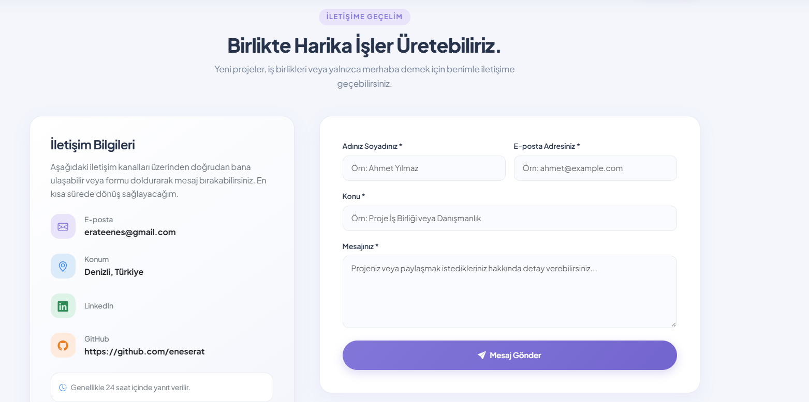
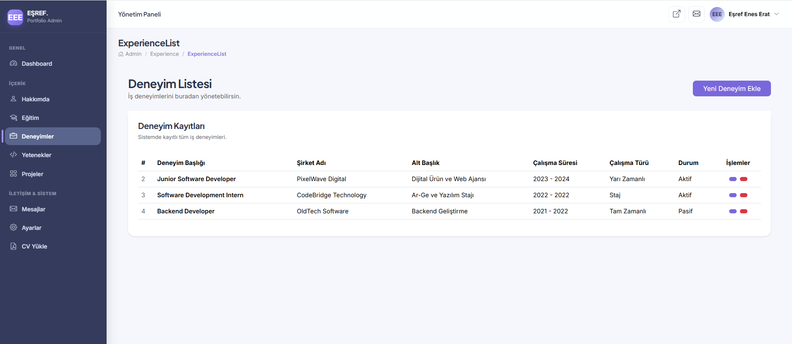
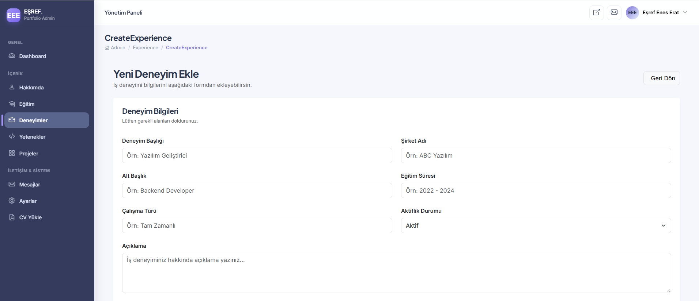
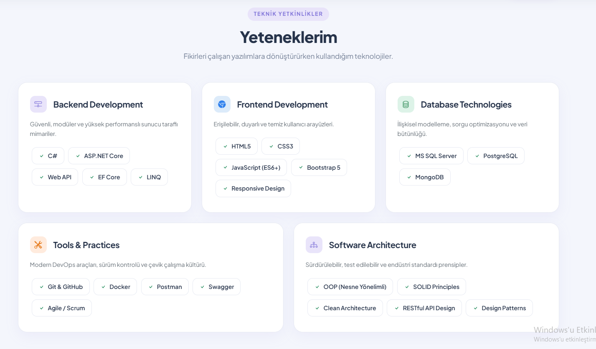
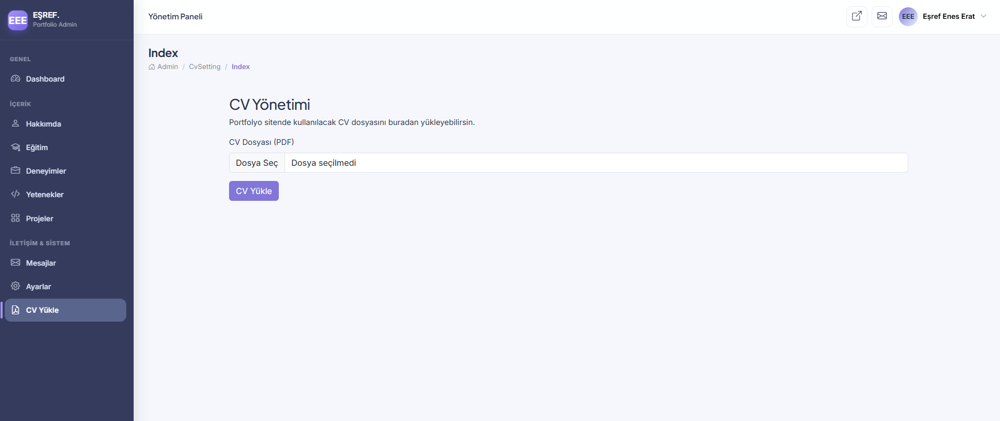

# MyAcademyPortfolio

**ASP.NET Core MVC ile geliştirilmiş, yönetim paneli üzerinden güncellenebilen kişisel portföy web uygulaması.**

MyAcademyPortfolio; kişisel bilgileri, eğitim ve iş deneyimlerini, teknik yetkinlikleri ve projeleri ziyaretçilere modern bir arayüzle sunmayı amaçlayan dinamik bir portföy projesidir. Uygulama, içeriklerin yönetilebilmesi için ayrıca ASP.NET Core MVC Area yapısı üzerinde oluşturulmuş bir yönetim paneli içerir.

> Bu depo, projenin mevcut geliştirme durumunu yansıtır. Aşağıdaki özellikler kaynak kodu ve paylaşılan uygulama ekranları esas alınarak listelenmiştir.

---

## İçindekiler

- [Öne Çıkan Özellikler](#öne-çıkan-özellikler)
- [Ekran Görüntüleri](#ekran-görüntüleri)
- [Kullanılan Teknolojiler](#kullanılan-teknolojiler)
- [Proje Yapısı](#proje-yapısı)
- [Veri Modeli](#veri-modeli)
- [Mevcut Kapsam ve Geliştirme Notları](#mevcut-kapsam-ve-geliştirme-notları)
- [Geliştirici](#geliştirici)

## Öne Çıkan Özellikler

### Ziyaretçi arayüzü

- Kişisel tanıtım ve hero alanı
- Hakkımda, eğitim, deneyim, yetenek ve proje bölümleri
- Teknik yetkinlikleri kategoriler halinde sunan kart yapısı
- İletişim bilgileri ve mesaj gönderme formu
- CV dosyasını PDF olarak indirme
- Instagram, LinkedIn ve GitHub bağlantılarını site ayarlarından yönetebilme
- Tek sayfa akışında bölüm bazlı gezinme

### Yönetim paneli

- ASP.NET Core MVC **Areas** yaklaşımıyla ayrılmış Admin alanı
- Dashboard üzerinde proje, yetenek, deneyim, eğitim ve mesaj sayıları
- Okunmamış mesaj sayısı ve son beş mesajın gösterilmesi
- Hakkımda bilgilerinin güncellenmesi
- Eğitim kayıtları için listeleme, ekleme, güncelleme ve silme
- İş deneyimleri için listeleme, ekleme, güncelleme ve silme
- Deneyimlerde şirket, pozisyon, çalışma türü, süre ve aktif/pasif durum bilgileri
- Yetenek kategorileri için listeleme, ekleme, güncelleme ve silme
- Proje ekleme ve proje listesini görüntüleme
- Projeleri kategori ve ilişkili yetenekleriyle birlikte listeleme
- Gelen mesajları listeleme, detayını görüntüleme ve silme
- Mesaj detayına girildiğinde mesajın okunmuş olarak işaretlenmesi
- Site başlığı ve sosyal medya bağlantılarının yönetimi
- Yönetim panelinden PDF formatında CV yükleme

## Ekran Görüntüleri

Aşağıdaki görseller proje arayüzünden alınmıştır. Görseller README ile **aynı klasörde** tutulur; ayrıca `screenshots` veya `docs` klasörü oluşturmanız gerekmez.

### Ziyaretçi arayüzü





### Yönetim paneli











## Kullanılan Teknolojiler

| Teknoloji | Kullanım amacı |
|---|---|
| C# | Uygulama geliştirme dili |
| ASP.NET Core MVC | Web uygulaması ve MVC mimarisi |
| Razor Views | Sunucu taraflı arayüz oluşturma |
| Entity Framework Core 9 | ORM ve veritabanı işlemleri |
| Microsoft SQL Server | İlişkisel veritabanı |
| Bootstrap 5 | Responsive arayüz bileşenleri |
| HTML5 / CSS3 | Sayfa yapısı ve görsel tasarım |
| JavaScript | İstemci tarafı etkileşimleri |
| Bootstrap Icons | Arayüz ikonları |

## Proje Yapısı

```text
MyAcademyPortfolio/
├── MyAcademyPortfolio.sln
└── MyAcademyPortfolio/
    ├── Areas/
    │   └── Admin/
    │       ├── Controllers/
    │       ├── Models/
    │       ├── Data/
    │       ├── ViewComponents/
    │       └── Views/
    ├── Context/
    │   └── PortfolioContext.cs
    ├── Controllers/
    ├── Entities/
    ├── Migrations/
    ├── Models/
    ├── ViewComponents/
    ├── Views/
    ├── wwwroot/
    │   ├── css/
    │   ├── js/
    │   ├── lib/
    │   └── uploads/
    ├── appsettings.json
    ├── Program.cs
    └── MyAcademyPortfolio.csproj
```

## Veri Modeli

Uygulamadaki temel entity sınıfları:

- **About:** Kişisel tanıtım bilgileri
- **Education:** Eğitim geçmişi
- **Experience:** İş deneyimleri ve aktiflik durumu
- **Skill / SkillItem:** Yetenek kategorileri ve kategori altındaki teknik yetkinlikler
- **Project:** Portföy projeleri
- **Category:** Proje kategorileri
- **ProjectSkill:** Proje ve yetenek kayıtları arasındaki ilişki
- **Message:** İletişim formundan gelen mesajlar ve okunma durumu
- **SiteSetting:** Site başlığı ve sosyal medya bağlantıları
- **HeroSection / Contact:** Ana sayfa ve iletişim alanlarında kullanılan içerik modelleri

Proje-kategori ilişkisi ve proje-yetenek eşleştirmesi Entity Framework Core üzerinden modellenmiştir.


## Mevcut Kapsam ve Geliştirme Notları

README, kaynak kodunda doğrulanabilen işlevleri listeler. Projenin mevcut sürümünde aşağıdaki noktalar ayrıca geliştirmeye açıktır:

- **Proje yönetimi:** Controller tarafında proje listeleme ve ekleme akışları bulunuyor. Proje güncelleme ve silme işlemleri mevcut kodda tamamlanmış görünmüyor.
- **Admin erişim güvenliği:** İncelenen `Program.cs` ve Admin controller kodlarında kimlik doğrulama/yetkilendirme akışı yapılandırılmış görünmüyor. İnternete açık yayına almadan önce yönetim paneli mutlaka yetkilendirme ile korunmalıdır.
- **Dosya yükleme güvenliği:** CV yükleme akışında dosya uzantısı kontrol ediliyor. Yayın öncesinde dosya boyutu sınırı, içerik/MIME doğrulaması, güvenli dosya adı ve mevcut dosyanın güvenli değiştirilmesi gibi kontroller eklenmelidir.
- **Veri doğrulama:** Formlarda sunucu taraflı model doğrulama ve hata mesajları uçtan uca gözden geçirilmelidir.
- **Bağlantı dizesi:** Yerel makineye özgü SQL Server adresi yerine ortama göre yapılandırma kullanılmalıdır.

Bu notlar projenin mevcut durumunu şeffaf biçimde belirtmek ve sonraki geliştirme adımlarını görünür kılmak amacıyla eklenmiştir.

## Geliştirici

**Eşref Enes Erat**  

- GitHub: [github.com/eneserat](https://github.com/eneserat)
- Konum: Denizli, Türkiye

---

<p align="center">
  ASP.NET Core MVC ile geliştirilmiştir.
</p>
